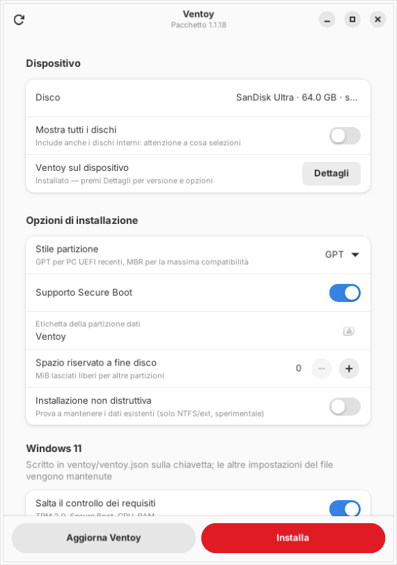

# Ventoy GTK4

Interfaccia grafica moderna (Python + GTK4/libadwaita) per [Ventoy](https://www.ventoy.net) su Linux.
Non sostituisce Ventoy: raccoglie le opzioni e lancia lo script ufficiale `Ventoy2Disk.sh` del pacchetto, con i privilegi di root ottenuti tramite `pkexec`.



## Funzioni

- Elenco delle chiavette USB e dei dischi rimovibili, aggiornato da solo quando ne colleghi o scolleghi una (i dischi interni si mostrano solo su richiesta)
- Riconosce le chiavette che hanno già Ventoy e ne legge versione, stile di partizione e Secure Boot
- Installazione, reinstallazione forzata, aggiornamento e installazione non distruttiva
- Opzioni: GPT/MBR, Secure Boot, etichetta della partizione, spazio riservato a fine disco
- Interruttori per Windows 11 (salto del controllo requisiti, account locale) scritti in `ventoy/ventoy.json` senza toccare il resto del file
- Montaggio e apertura della partizione dati per copiarci le ISO
- Registro dello script in tempo reale e conferma esplicita prima di ogni operazione distruttiva

## Requisiti

- Il [pacchetto Linux di Ventoy](https://github.com/ventoy/Ventoy/releases) (`ventoy-x.y.z-linux.tar.gz`)
- Python 3 con PyGObject, GTK 4 e libadwaita ≥ 1.5
- `pkexec` (polkit), `lsblk`, `udisksctl`

Su Ubuntu/Debian:

```bash
sudo apt install python3-gi gir1.2-gtk-4.0 gir1.2-adw-1 policykit-1 udisks2
```

## Uso

Dalla cartella del repository:

```bash
./ventoy-gtk4                    # apre l'interfaccia
./ventoy-gtk4 --install-desktop  # aggiunge "Ventoy" al menu delle applicazioni
```

Il lanciatore del menu (con l'icona in `icons/`, copiata in `~/.local/share/icons/hicolor`) punta a questa copia della GUI, quindi dopo un `git pull` usi già la versione aggiornata. Eventuali vecchi lanciatori che aprivano la GUI GTK3 originale (`VentoyGUI.x86_64`) vengono rinominati in `.bak`.

### Il pacchetto Ventoy

I sorgenti del repository non contengono i file compilati (`boot/boot.img`, strumenti in `tool/`), quindi la GUI ha bisogno di un pacchetto Linux di Ventoy già estratto, scaricato dalle [release](https://github.com/ventoy/Ventoy/releases) (`ventoy-x.y.z-linux.tar.gz`). Lo cerca in quest'ordine:

1. `--ventoy-dir DIR` o la variabile d'ambiente `VENTOY_DIR`
2. l'ultima cartella scelta, salvata in `~/.config/ventoy-gtk4/config.json`
3. la cartella in cui si trova `VentoyGTK4.py` (così funziona anche copiato dentro un pacchetto)
4. le cartelle `ventoy-*` in `~`, `~/Downloads`, `~/Documents/*`, `/opt` (prende la versione più recente)

Se non lo trova, compare un avviso con il pulsante per sceglierlo; il pulsante con la cartella in alto a destra permette di cambiarlo in qualsiasi momento.

Nei pacchetti generati da questo fork `VentoyGTK4.py` è già incluso (lo aggiunge `INSTALL/ventoy_pack.sh`, insieme alla cartella `icons/`).

## Note

- Solo la chiamata a `Ventoy2Disk.sh` gira come root; l'interfaccia resta in esecuzione come utente normale.
- Come per la GUI ufficiale, lo script scrive `log.txt` e la prima volta scompatta gli strumenti in `tool/`: quei file risulteranno di proprietà di root.
- Le conferme interattive dello script ricevono automaticamente "y", perché la conferma viene già chiesta dall'interfaccia.

## Licenza

GPL-3.0, come il resto di Ventoy. Ventoy è © longpanda; questa interfaccia è un contributo indipendente, non affiliato al progetto ufficiale.
